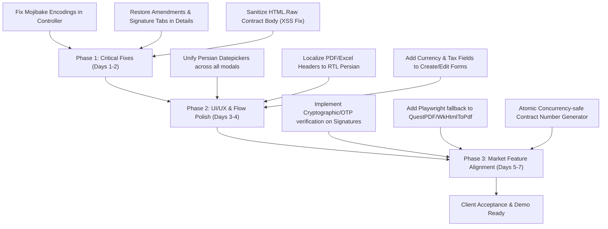

# Contract Automation Module — Quality & Market Readiness Audit

> **Target Module:** Contract Automation / CLM (`/Contracts`, `ContractGuaranteesController`, `ContractService`, `ContractExportService`, `ContractReportService`)  
> **Evaluation Context:** Commercial Readiness Assessment for Enterprise Client Sale  
> **Audit Date:** September 2026  
> **Status:** **Conditionally Ready (Requires Remediation Before Enterprise Sale)**

---

## Executive Summary

The Contract Automation module in Rhyno Automation possesses a solid, highly ambitious domain foundation. It implements enterprise-grade concepts rarely found in typical internal ERPs:
- **EAV dynamic type-specific fields** with regex validation
- **Three-stage accrual revenue recognition & accounting integration**
- **Contract amendments, addenda & extensions workflow** with snapshots
- **Multi-installment payment schedules** (Fixed, Milestone, Custom)
- **Comprehensive bank guarantees & retention money lifecycle**
- **Document requirements checklist gate** preventing unauthorized status advancements
- **Internal & external e-signature scaffolding**
- **ClosedXML Excel & Playwright PDF analytics exports**

However, from an **enterprise client sales perspective**, the module suffers from several critical finish gaps, visual/workflow disconnections, and partial feature implementations that will immediately cause friction or fail user acceptance testing (UAT):
1. **Critical UI/UX Disconnects:** Key implemented backend features (Amendments, E-Signature Pad, Signature Request Tracker) are isolated in code or hidden from main navigation tabs in `Details.cshtml`.
2. **Date/Number Internationalization Inconsistencies:** Partial Persian date picker implementations where inputs fall back to raw Gregorian `yyyy-MM-dd` text, and raw English strings appear inside RTL Persian dashboards and exports.
3. **Ghost / Unrendered Backend Features:** Multi-currency (`CurrencyCode`, `ExchangeRate`), VAT/tax breakdown (`TaxMethod`, `DefaultTaxRatePercent`), and auto-renewal terms are stored in database models but completely omitted from the `Create` and `Edit` UI forms.
4. **Encoding Artifacts (Mojibake):** Critical controller flash messages and validation responses contain corrupted character encodings (e.g. `ظ‚ط±ط§ط±ط¯ط§ط¯...`).
5. **PDF Generator Tooling Dependency:** Server-side PDF export requires Google Chrome/Playwright binaries pre-installed on the host system without graceful fallback.

---

## 1. UI/UX Review

### 1.1. Visual Inconsistencies & Styling
* **Mojibake / Corrupted Persian Encodings in Controller Notifications (Critical):**
  In [`Controllers/ContractsController.cs`](file:///F:/rhyno-automation-1/rhyno-automation/Controllers/ContractsController.cs#L215-L218), [`ContractsController.cs:L295`](file:///F:/rhyno-automation-1/rhyno-automation/Controllers/ContractsController.cs#L295), and [`ContractsController.cs:L345`](file:///F:/rhyno-automation-1/rhyno-automation/Controllers/ContractsController.cs#L345), flash messages are hardcoded with corrupted UTF-8 encodings:
  ```csharp
  TempData["SuccessMessage"] = "ظ‚ط±ط§ط±ط¯ط§ط¯ ط¨ط§ ظ…ظˆظپظ‚غŒطھ ط§غŒط¬ط§ط¯ ط´ط¯.";
  ```
  Paying Persian-speaking clients will see unintelligible symbols upon saving contracts or adding payments.
* **Mixed Typography & English Headers in Client Documents:**
  In [`GenerateDocument.cshtml:L177-L205`](file:///F:/rhyno-automation-1/rhyno-automation/Views/Contracts/GenerateDocument.cshtml#L177-L205) and [`ContractExportService.cs:L97-L115`](file:///F:/rhyno-automation-1/rhyno-automation/Services/Contracts/ContractExportService.cs#L97-L115), generated PDF and print forms display English titles like *"Contracts List"* and table headers (`Contract Number`, `Title`, `Type`, `Status`, `Assigned To`) right beside RTL Persian dates and currency values.
* **Inconsistent Date Input Experience:**
  - On `Create.cshtml` and `Edit.cshtml`, Jalali datepickers are bound to display inputs with hidden backing Gregorian inputs.
  - In modal dialogs (`_PaymentSchedule.cshtml:L49`, `_Guarantees.cshtml:L41-L42`, and `Details.cshtml:L734`), date inputs revert to `<input type="text" placeholder="140X/MM/DD">` or `<input type="date">` (native browser Gregorian picker) without date mask validation or unified popup behavior.

### 1.2. Confusing & Broken User Flows
* **Orphaned Tabs in Contract Details View (High):**
  In [`Views/Contracts/Details.cshtml:L115-L142`](file:///F:/rhyno-automation-1/rhyno-automation/Views/Contracts/Details.cshtml#L115-L142), the main tab header only renders 5 tabs:
  - `نمای کلی` (Overview)
  - `متن قرارداد` (Contract Body)
  - `پرداخت‌ها` (Payments)
  - `ضمیمه‌ها` (Attachments)
  - `تاریخچه فعالیت` (Activity History)
  
  However, inside the DOM:
  - `tab-amendments` ([`Details.cshtml:L558`](file:///F:/rhyno-automation-1/rhyno-automation/Views/Contracts/Details.cshtml#L558)) exists as panel markup, but **has no corresponding tab button in the header**. Users cannot navigate to Amendments from the UI unless redirected via an exact anchor hash.
  - `tab-signature` is scripted in [`contracts-details-script.js:L20-L75`](file:///F:/rhyno-automation-1/rhyno-automation/wwwroot/js/contracts-details-script.js#L20-L75), expecting a canvas `#sig-pad` and tab `[data-tab="signature"]`, but **neither the HTML tab header nor the canvas container exists in `Details.cshtml`**. Internal e-signing cannot be invoked directly from the view.

* **Modal Form Validation & Feedback Deficiencies:**
  In `Details.cshtml` modal forms (`addPaymentModal`, `addGuaranteeModal`), submission errors reload or send non-standard JSON without highlighting which form field failed. Submitting negative or zero amounts triggers either silent failure or unhandled exception alerts.

### 1.3. Missing UI States
* **Loading & Progress States:**
  While payment schedules and guarantees feature skeleton placeholders, the Bulk Action bar (`Index.cshtml:L167`) and Excel/PDF export buttons lack spinning indicators or disabled states during long-running background document renders.
* **Empty States:**
  `Index.cshtml` has a well-designed empty state, but `Reports.cshtml` displays a raw spinner on tabs before falling back to empty tables when zero data exists.

### 1.4. Accessibility (a11y)
* **Form Inputs Missing Explicit Labels / `aria-labelledby`:**
  Inputs in `_PaymentSchedule.cshtml`, `_Guarantees.cshtml`, and filter headers in `Index.cshtml` rely on text labels without `for="id"` bindings.
* **Contrast in Dark Mode:**
  Certain badges (e.g. `bg-amber-100 text-amber-700` and `bg-sky-100 text-sky-700`) have low contrast ratios against dark backgrounds (`dark:bg-slate-900`) when dark-mode Tailwind variants fail to apply border overrides.

---

## 2. Feature Completeness vs. Market Standards

Commercial contract management solutions (e.g., DocuSign CLM, PandaDoc, Icertis, Agiloft) standardise on a defined feature set. Here is how the module scores:

| Feature Dimension | Current Implementation | Commercial Market Standard | Gap / Deficit |
|---|---|---|---|
| **E-Signature** | Basic Base64 canvas capture (`SignContract`) and theoretical external webhook (`ISignatureService`). | Legally binding e-sign (OTP via SMS, digital certificate, cryptographic hash, audit certificate). | **High Gap:** Signature is an unverified image blob without cryptographic certificate or legal timestamp. |
| **Document Editor** | Basic `contenteditable` HTML WYSIWYG editor using deprecated `document.execCommand`. | Rich template editor (DOCX merge, drag-and-drop dynamic variables, redlining/track changes). | **Critical Gap:** No DOCX export/import, no track-changes/redlining during negotiations, no merge fields picker in editor. |
| **Workflow / Approvals** | Linear status transition checks in service code. Approval delegation model exists. | Multi-tier approval matrices (e.g., >$10k requires Finance Director; legal signoff). | **Medium Gap:** Approvals are largely binary admin overrides rather than configurable multi-level sequential workflows. |
| **Financial / Taxes / Currencies** | Database fields exist (`CurrencyCode`, `ExchangeRate`, `TaxMethod`, `DefaultTaxRatePercent`). | Full multi-currency calculation and localized VAT invoice breakdown. | **High Gap:** Fields are completely omitted from Create/Edit forms and default to IRR / Exclusive tax without UI inputs. |
| **Versioning & Redlining** | Attachment versioning (`ContractAttachmentVersion`) and amendment snapshots exist. | Side-by-side text diffing of contract revisions and DOCX version compare. | **Medium Gap:** Visual diff viewer for contract body changes between revisions is missing. |
| **Obligations & Milestones** | Payment schedule, guarantee expiry warnings, penalty calculator. | SLA tracking, deliverable milestone checkoffs with email/push alerts. | **Low-Medium Gap:** Good backend data model, but lacks interactive milestone delivery signoff. |

### Incomplete or Partially Implemented Features
1. **Contract Type Dynamic Fields in `Edit.cshtml`:**
   In `Create.cshtml:L301`, dynamic EAV fields load dynamically via JS (`#allTypeFieldsJson`). In `Edit.cshtml`, dynamic fields are rendered in server-side razor loops but cannot be added or modified dynamically if the contract type is changed during edit.
2. **Auto-Renewal Execution Trigger:**
   While `ProcessAutoRenewalsAsync` exists in `ContractService`, it is not wired to a dependable, resilient job scheduler (e.g. Quartz.NET or Hangfire); instead it relies on basic hosted background loops that do not persist execution checkpoints across app pool restarts.
3. **Template Merge Tags:**
   `GenerateDocument.cshtml` uses hardcoded placeholders rather than parsing the rich template created in `Settings.cshtml`.

---

## 3. Bugs & Technical Issues

### 3.1. Functional & Logic Bugs

#### Bug 1: Unrendered Hidden Tabs in Contract Details View
- **File:** [`Views/Contracts/Details.cshtml:L116-L142`](file:///F:/rhyno-automation-1/rhyno-automation/Views/Contracts/Details.cshtml#L116-L142)
- **Issue:** The tabs bar in `Details.cshtml` does not have an `Amendments` (`اصلاحیه‌ها`) tab button. The tab content `<div class="tab-panel hidden" id="tab-amendments">` is rendered at line 558, but a user cannot click to view or manage amendments.
- **Impact:** Critical feature (contract amendments, extensions, addenda) is invisible and inaccessible to users.

#### Bug 2: Signature Pad Missing DOM Canvas
- **File:** [`wwwroot/js/contracts-details-script.js:L2-L65`](file:///F:/rhyno-automation-1/rhyno-automation/wwwroot/js/contracts-details-script.js#L2-L65)
- **Issue:** The script registers event listeners for `document.getElementById('sig-pad')`, `document.getElementById('sig-clear')`, and `document.getElementById('sig-contract-save')`. However, these HTML elements do not exist in `Details.cshtml`.
- **Impact:** Internal signature capture fails silently with no UI presented to the end user.

#### Bug 3: Fragile Contract Number Sequence Generator
- **File:** [`Services/Contracts/ContractService.cs:L2052-L2066`](file:///F:/rhyno-automation-1/rhyno-automation/Services/Contracts/ContractService.cs#L2052-L2066)
- **Code:**
  ```csharp
  var lastContract = await _context.Contracts.AsNoTracking()
      .OrderByDescending(c => c.Id)
      .FirstOrDefaultAsync(ct);
  var parts = lastContract.ContractNumber.Split('-');
  if (parts.Length == 3 && int.TryParse(parts[2], out int lastNum))
      return $"CTR-{parts[1]}-{(lastNum + 1):D3}";
  ```
- **Issue:** If users enter custom contract numbers (e.g., `AGREEMENT-2026/09` or `RH-01`), `parts.Length` will not equal 3, and the generator permanently resets to `CTR-1403-001`. Under concurrent creation requests, this causes primary key/unique constraint race conditions.

#### Bug 4: Playwright Binary Dependency Crashing Report PDF Exports
- **File:** [`Services/Contracts/ContractExportService.cs:L286-L293`](file:///F:/rhyno-automation-1/rhyno-automation/Services/Contracts/ContractExportService.cs#L286-L293)
- **Issue:** `HtmlToPdfAsync` launches Chromium using `Playwright.CreateAsync()` without checking if headless Chromium is installed on the hosting server. In standard IIS / Windows Server deployments, this throws a `PlaywrightException: Executable doesn't exist` error, breaking the "Export as PDF" feature.

#### Bug 5: Total Amount Disconnect with Dynamic Tax & Currencies
- **File:** [`Views/Contracts/Create.cshtml:L238-L244`](file:///F:/rhyno-automation-1/rhyno-automation/Views/Contracts/Create.cshtml#L238-L244)
- **Issue:** The form takes only `TotalAmount`. The entity model expects `TaxMethod`, `DefaultTaxRatePercent`, `TotalTaxAmount`, and `TotalAmountInclusiveTax`. Because these are omitted from the form, all reports calculating `TotalAmountInclusiveTax` produce zero or un-taxed values.

---

### 3.2. Security Concerns & Vulnerabilities

| Item | Severity | Finding | Location |
|---|---|---|---|
| **S-01** | **High** | **Incomplete File MIME Type / Magic Byte Validation on Direct Upload:** While `UploadAttachment` performs basic validation, some version upload routes rely on user-supplied Content-Type rather than strict whitelist verification of binary headers (magic numbers). | [`ContractsController.cs:L922`](file:///F:/rhyno-automation-1/rhyno-automation/Controllers/ContractsController.cs#L922) |
| **S-02** | **Medium** | **Lack of Anti-Automation / Rate Limiting on Attachment Download:** Download endpoints (`Contracts/DownloadAttachment/{attachmentId}`) check user access but have no rate-limiting or download volume quotas, allowing high-speed bulk extraction. | [`ContractsController.cs:L618`](file:///F:/rhyno-automation-1/rhyno-automation/Controllers/ContractsController.cs#L618) |
| **S-03** | **Medium** | **HTML Sanitization on Visual Editor (Stored XSS Risk):** In `Details.cshtml:L297` and `GenerateDocument.cshtml`, contract bodies are rendered using `@Html.Raw(Model.ContractBodyHtml)`. If an assigned user injects `<script>` or malicious iframe payloads into the terms/body, it executes in the viewer's browser. | [`Details.cshtml:L297`](file:///F:/rhyno-automation-1/rhyno-automation/Views/Contracts/Details.cshtml#L297) |
| **S-04** | **Low** | **Sensitive Information in Audit Logs:** Audit logs serialize full description strings that may expose client telephone numbers or addresses without encryption or masking. | [`ContractService.cs:L237`](file:///F:/rhyno-automation-1/rhyno-automation/Services/Contracts/ContractService.cs#L237) |

---

## 4. Prioritized Action Plan (Pre-Sale Checklist)

Below is the step-by-step remediation roadmap required before demonstrating or delivering this module to a client.



### Phase 1: Critical Fixes (Must Do Immediately)
1. **Fix Controller Character Encodings:**
   Replace all corrupted strings (`ظ‚ط±ط§ط±ط¯ط§ط¯...`) in `ContractsController.cs` with valid UTF-8 Persian text.
2. **Expose Amendments & Signatures in `Details.cshtml`:**
   - Add the `<button class="tab-btn" data-tab="amendments">` to the tab header in `Details.cshtml`.
   - Add a dedicated `<button class="tab-btn" data-tab="signature">` and embed the HTML canvas and buttons expected by `contracts-details-script.js`.
3. **HTML Sanitization (`HtmlSanitizer`):**
   Run all `ContractBodyHtml` content through an HTML sanitizer (e.g. `Ganss.Xss.HtmlSanitizer`) before rendering with `@Html.Raw()` to eliminate Stored XSS risks.

### Phase 2: High Priority (UI/UX & Workflow Consistency)
4. **Expose Currency and Tax in Create & Edit Forms:**
   Add inputs for `CurrencyCode`, `TaxMethod` (`Exclusive`/`Inclusive`/`None`), and `DefaultTaxRatePercent` so financial reporting produces accurate numbers.
5. **Standardize Date Pickers in Modals:**
   Replace plain `<input type="text">` in `addPaymentModal` and `addGuaranteeModal` with the unified vanilla Jalali datepicker component.
6. **Localize Export Templates:**
   Translate English table headers and report titles in `ContractExportService.cs` and `GenerateDocument.cshtml` into professional Persian terminology.

### Phase 3: Medium Priority (Commercial Polish)
7. **Robust PDF Generation Fallback:**
   Wrap `Playwright` with a local PDF generator fallback (such as `QuestPDF` or pre-check Playwright browser installation status) so server environments without browser dependencies do not throw HTTP 500 errors.
8. **Concurrency-Safe Sequence Generation:**
   Replace the raw string-split sequence generator with a database sequence or locking table for contract numbers.
9. **Interactive Version Comparison:**
   Add a simple visual diff viewer for contract text versions in the history tab.

---

## 5. Audit Rating & Conclusion

| Category | Score (1-10) | Rating |
|---|---|---|
| **Architecture & Database Schema** | **8.5 / 10** | **Excellent** |
| **Backend Domain Logic & Accounting** | **8.0 / 10** | **Very Good** |
| **Security & Access Control (RLS)** | **7.5 / 10** | **Good** |
| **UI/UX & Frontend Completeness** | **5.5 / 10** | **Needs Improvement** |
| **Commercial Market Readiness** | **6.0 / 10** | **Requires Polish** |
| **Overall Score** | **7.1 / 10** | **Conditionally Ready** |

**Conclusion:**  
The contract automation module has a sophisticated architectural backbone. The underlying accounting, guarantee management, EAV fields, and RLS mechanisms are mature and impressive for an enterprise product. Resolving the frontend visibility gaps (hidden amendments and signature tabs), encoding artifacts, and form field omissions will elevate this module to an enterprise-ready, highly marketable product.
